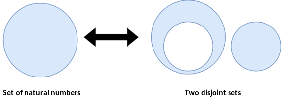

# Mathematical Foundations

Interleaving and de-interleaving are based on partitioning sample positions into two disjoint, ordered sets. Beatty sequences and Fraenkel's theorem describe such a partition and allow exact index mappings to be derived. This page presents the underlying theorems; the following chapters define the operators and show how the system uses them.

In 1926, Samuel Beatty published the following theorem [\[1\]](../references.md#1):

If p, q are positive irrational numbers satisfying the relation

\\[
\frac{1}{p}+\frac{1}{q}=1
\\]

then the sequences

\\[
\left\\{
\left\lfloor np\right\rfloor \right\\} _{n=1}^{\infty }=\left\lfloor
p\right\rfloor ,\left\lfloor 2p\right\rfloor ,\left\lfloor 3p\right\rfloor
,\ldots
\\]

and

\\[
\left\\{ \left\lfloor nq\right\rfloor \right\\}
_{n=1}^{\infty }=\left\lfloor q\right\rfloor ,\left\lfloor 2q\right\rfloor
,\left\lfloor 3q\right\rfloor ,\ldots
\\]

partition the set of positive integers.

<figure><figcaption>
Fig. 1. Graphical representation of the concept of disjoint sets
</figcaption></figure>

Each positive integer therefore belongs to exactly one of these sequences (Fig. 1). The condition relating p and q ensures both disjointness and complete coverage of the set.

Computing these positions directly with floating-point approximations requires care: a small error near an integer can change the result of floor or ceiling and select a different sample. RetractorDB needs a variant in which intervals and index mappings can be computed exactly using rational numbers.

The generalization presented by Aviezri S. Fraenkel in 1969 [\[2\]](../references.md#2) provides that possibility. Its starting point is a parameterized Beatty sequence:

\\[
\mathcal{B}(\alpha ,\alpha ^{\prime }):=
\left( \left\lfloor \frac{n-\alpha^{\prime }}{\alpha }\right\rfloor \right) _{n=1}^{\infty }
\\]

This single definition generates an entire family of sequences. The theorem always concerns a **pair** of its instances with different parameters: the sequence

\\[
\mathcal{B}(\alpha ,\alpha ^{\prime })
\quad\text{and}\quad
\mathcal{B}(\beta ,\beta ^{\prime }):=
\left( \left\lfloor \frac{n-\beta^{\prime }}{\beta }\right\rfloor \right) _{n=1}^{\infty }
\\]

These sequences partition the set ℕ if and only if the following five conditions are satisfied:

1\.

\\[
0<\alpha<1
\\]

2\.

\\[
\alpha+\beta=1
\\]

3\.

\\[
0\leq \alpha +\alpha ^{\prime }\leq 1
\\]

4. If α is an irrational number, then:

\\[
\alpha ^{\prime }+\beta ^{\prime }=0
\\]

and

\\[
k\alpha +\alpha ^{\prime }\not\in \mathbb{Z}
\\]

for

\\[
2\leq k\in \mathbb{N}
\\]

5. If α is a rational number (let q∈N be the smallest number such that qα∈N), then

\\[
\frac{1}{q}\leq \alpha +\alpha ^{\prime }
\\]

and

\\[
\left\lceil q\alpha ^{\prime }\right\rceil +\left\lceil q\beta ^{\prime}\right\rceil =1
\\]

Allowing rational parameters makes it possible to derive the operators used in RetractorDB without approximating sample positions. The implementation must also respect the limits of its numeric representation; a mathematical theorem does not remove the limits of machine types.

[Algebra of Regular Time Series](algebra-of-regular-time-series.md) defines the operators, and [Formal Foundations and Proofs](formal-foundations-and-proofs.md) proves their properties. Its [section on the connection to the implementation](formal-foundations-and-proofs.md#connecting-proofs-to-the-implementation) describes the Lean formalization and the checks comparing C++ functions with the model. The historical derivation of the method is presented in publication [\[3\]](../references.md#3).
