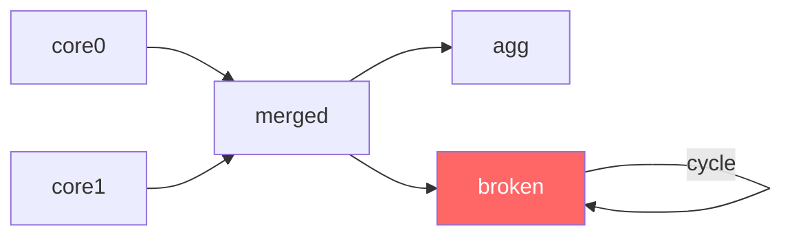

# Loop Detection in Compilation

The query dependency graph must be a directed acyclic graph (DAG). If a query refers - directly or indirectly - to its own results, a cycle is created. The compiler detects this situation and aborts compilation with an error.

> **_NOTE:_** The functionality described here is covered by the test: `issue95_loopInCompile`, described in the appendix [Integration Tests](../appendices/integration-tests.md).

## Example of a loop

```rql
DECLARE a BYTE, b INTEGER STREAM core0, 0.1 TEXTFILE 'sensor_a.txt'
DECLARE c INTEGER, d FLOAT STREAM core1, 0.2 TEXTFILE 'sensor_b.txt'

SELECT merged[0]*10, merged[2]+10 STREAM merged FROM core0 + core1
SELECT *                          STREAM agg    FROM MAX(merged)
SELECT *                          STREAM broken FROM merged + broken
```

The last query defines `broken` as the result of the operation `merged + broken` - the stream depends on itself. The dependency graph contains a cycle (Fig. 41):



_Fig. 41. A cycle in the query dependency graph_

## Compilation result

Attempting to compile such a file ends with an error:

```
$ xretractor brokenQuery.rql -c 2>out.txt
$ echo $?
71
$ cat out.txt
Input file:brokenQuery.rql
Check result:Circular dependency in stream definitions
```

The message `"Circular dependency in stream definitions"` appears when the `resolveStreamIntervals` stage leaves unresolved streams and resolves no new stream during the entire round. The exit code `71` shown above applies to Linux. For how to run compilation and read error messages, see [Compilation Debugging](compilation-debugging.md).

## Detection mechanism

On every round, the `resolveStreamIntervals` stage counts streams waiting for a source interval (`unresolvedCount`) and streams that have just obtained their first known interval (`resolvedThisPass`). When `unresolvedCount == 0`, the stage succeeds. Otherwise, it checks:

```cpp
if (resolvedThisPass == 0) {
  SPDLOG_ERROR("Circular dependency: stream interval resolution stalled with {} unresolved streams", unresolvedCount);
  return {"Circular dependency in stream definitions"};
}
```

Before this stage, the compiler checks that sources exist and declared intervals are positive. A known interval remains known. If the unresolved part of the graph is acyclic, it contains a node whose sources are all already resolved, so at least one new stream is resolved during the round. No such progress with a nonempty unresolved part means there is a cycle. Streams independent of the cycle may have been resolved earlier.

Sorting at this stage is by interval, not topologically. A valid plan can therefore require several rounds, but it cannot stall without progress. [Interval Resolution](interval-resolution.md) gives the details and a visit-order example.

The older comparison `unresolvedCount >= prevUnresolved` also detects a lack of progress if every unresolved node is counted correctly and resolved nodes remain resolved. The current implementation checks the number of newly resolved streams directly.

## How to fix it

Remove the stream's reference to itself, or to a stream that depends on it. In the example above, the query:

```rql
SELECT * STREAM broken FROM merged + broken
```

should be replaced with a reference to a stream that exists independently of `broken`:

```rql
SELECT * STREAM broken FROM merged + core0
```
