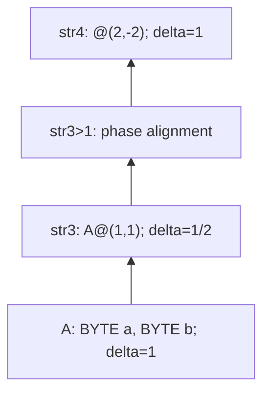

# Serialization Example

Let's start by creating a file qplan3.rql with the following content:

```rql
DECLARE a BYTE, b BYTE STREAM A, 1 TEXTFILE 'data3.txt'
SELECT * STREAM str3 FROM A@(1,1)
```

And let's prepare a file data3.txt with the following content:

```
$ seq 0 9 | paste - -
```

```
0       1
2       3
4       5
6       7
8       9


```

The last, empty line matters and is significant. After running xretractor qplan3.rql, and in a second window xqry -s str3, we'll see something like this:

```
$ xqry --null -s str3
7
8
9
0
1
2
3
4
5
6
```

What we're seeing is an example of serialization. An interesting aspect of the Agse operator, in this case, is also visible in the query execution plan. We can look at it with the command:

```
$ xretractor -c qplan3.rql -f -p -d > out.dot && dot -Tsvg out.dot -o out.svg
```

In the out.svg file we'll see the following query execution plan (Fig. 53):

<figure><figcaption><p>Fig. 53. Query execution plan after AGSE compilation</p></figcaption></figure>

From a source stream, where data containing two bytes arrives every second, a data stream is created in which one byte appears every half second.

Now that we have a str3 data stream in the system, returning sequential numbers, we can use it for further transformations. Let's add the following query to the qplan3.rql file:

```rql
SELECT * STREAM str4 FROM str3@(2,2)
```

After running it, though, we won't see the expected original form of the data3.txt file. Instead, we'll see something like this:

```
$ xqry --null -s str4
2 1
4 3
6 5
8 7
0 9
2 1
4 3
6 5
```

The result puts the newest field first, and its pairs span elements at indices 1..2, 3..4 and so on. Changing the width's sign reverses field order:

```rql
SELECT * STREAM str4 FROM str3@(2,-2)
```

The first records of this stream are:

```
$ xqry --null -s str4
1 2
3 4
5 6
7 8
9 0
...
```

Arrival order is now preserved, but the pair `1 2` still combines fields from two adjacent source records. The minus sign alone does not change the window's phase. To recover the original pairs `0 1`, `2 3` and so on, replace the last query with:

```rql
SELECT * STREAM str4 FROM (str3>1)@(2,-2)
```

The `>1` shift makes positions 1..2 of the shifted stream carry elements 0..1 of `str3`. The negative width arranges them in arrival order. The first `str4` record has logical index 1, and successive records restore the source's values and grouping:

```
0 1
2 3
4 5
6 7
8 9
...
```

Generating an image of the query plan that carries out serialization first and then deserialization, we'll see the following relationship (Fig. 54):



_Fig. 54. Serialization, phase alignment and deserialization_

What's shown here is the most basic example of using the sliding-data-window operator. If we start experimenting with the hop and window size, we'll notice that we're able to create an arbitrary sliding window over the data stream, or skip some elements by building a hop larger than the window width.

<div class="no-print">

The historical recording below shows serialization and field reversal; it does not include the `>1` phase alignment added above:

<figure><figcaption><p>Animation. Session recording of the AGSE serializer experiment</p></figcaption></figure>

</div>

> **_NOTE:_** The functionality described here is covered by the tests: `agse1`, `agse2`, `agse3`, `Pattern6`, described in the appendix [Integration Tests](../../appendices/integration-tests.md).

