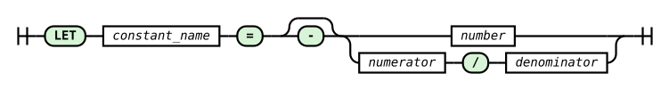

# LET Command

The `LET` command gives a name to a numeric constant. The plan can then refer to it as `?NAME` wherever it accepts a number: in the parameters of the `@` window, field indices, sizes, the shift, intervals, retention, `DUMP` bounds and expressions. The query then states the role of a parameter (`WINDOW_WIDTH`, `ALARM_LIMIT`) instead of repeating magic numbers, and changing a parameter means editing a single line.

A constant is not a variable: its value is fixed when the plan is loaded and does not change during execution. Numbers written directly into a query (literals) remain fully valid, and both forms may appear in one plan.

> **_NOTE:_** The functionality described here is covered by the tests: `let_constants` and `adhoc_parse_error`, described in the appendix [Integration Tests](../appendices/integration-tests.md), and by the compiler unit tests (`ut_compiler`).

## Syntax

```rql
LET constant_name = value
```



_Fig. 67. LET command syntax diagram_

The railroad diagram in Fig. 67 was generated from the `let_statement` rule in the system's ANTLR4 grammar (`RQL.g4`). The `LET` keyword is followed by the constant name, the `=` sign and the value: an integer or decimal number, or a fraction `numerator/denominator`, each with an optional minus sign.

A synthetic example:

```rql
LET SIGNAL_INDEX = 0
LET STATUS_INDEX = 1
LET WINDOW_STEP = 3
LET WINDOW_WIDTH = 16
LET ALARM_LIMIT = 250

DECLARE signal INTEGER, status INTEGER STREAM sample, 1 TEXTFILE 'sample.txt'
SELECT sample[?SIGNAL_INDEX], sample[?STATUS_INDEX] STREAM channels FROM sample
SELECT * STREAM block FROM channels@(?WINDOW_STEP, ?WINDOW_WIDTH)
RULE high_signal ON channels WHEN channels[?SIGNAL_INDEX] >= ?ALARM_LIMIT DO DUMP -1 TO 1
```

Compiling this plan (`xretractor -c`) yields exactly the same plan as the form with the literals `0`, `1`, `@(3, 16)` and `>= 250`.

### Right-hand side

The right-hand side is always **a single literal**:

| Form | Example | Notes |
|---|---|---|
| integer | `LET N = 16`, `LET OFFSET = -3` | range of a signed 32-bit integer |
| decimal | `LET GAIN = 0.5`, `LET T = 2.` | same form as an RQL floating-point literal; exponent notation (`1E3`) is not accepted |
| fraction | `LET SOURCE_INTERVAL = 1/40` | non-zero denominator |

An expression (`LET A = 1 + 2`), a reference to another constant (`LET B = ?A`) and a plus sign (`LET X = +1`) are syntax errors.

### Name and reference

A constant name starts with a letter and consists of letters, digits and underscores. The `$` character is not allowed, so that references are never confused with a stream-generator index. Names are case-sensitive: `?signal` and `?SIGNAL` are different constants.

A reference is a single token: the `?` character immediately followed by the name, with no space (`? NAME` is a lexer error). Constants have **a separate namespace**: `?X` is never a field or a stream, and a bare identifier `X` is never a constant. A constant may therefore share its name with a field, stream or function without a collision, and existing queries keep their meaning. A `?` inside a string, a path, a comment or a `SYSTEM` command remains plain text.

The word `LET` (also `let`) is reserved and cannot be the name of a stream, field or rule.

### Scope

- A constant is valid from the line of its declaration to the end of the plan file. `LET` may appear anywhere in the file, but before its first use; a reference before the declaration is an error.
- Declaring the same name again is an error; a constant cannot be overwritten.
- Constants belong to one plan: they do not carry over to another file, a later load or ad-hoc queries.
- An unused constant is not an error. `xretractor` prints a warning to stderr, also with `--quiet`, for example `xretractor: warning: line 2: constant ?UNUSED is declared but never used`. When the plan is reloaded through the reset channel, the same warning goes to the server log.

## Where a constant can be used

`?NAME` may appear wherever the grammar accepts a numeric literal. In every position it is subject to the same constraints as a literal (range, sign, the plan limits from the chapter [Plan Size Limits](../query-compilation/plan-size-limits.md)).

| Position | Form with a constant | Required value |
|---|---|---|
| `@` window parameters | `src@(?WINDOW_STEP, ?WINDOW_WIDTH)`, `src@(?STEP, -?WIDTH)` | integer; step > 0, width non-zero (negative as for a literal) |
| field index | `src[?FIELD_INDEX]` | integer, ≥ 0 |
| array field size | `INTEGER[?CHANNEL_COUNT]`, `STRING[?TEXT_WIDTH]` | integer, > 0 |
| stream family size | `STREAM result[?FAMILY_SIZE]` | integer, > 0 |
| generator index | `src[?LAST_INDEX-$]` | integer; index arithmetic as for a literal |
| shift | `src > ?SHIFT` | integer, ≥ 0 |
| record window | `AVG(src[?FIELD_INDEX] : ?HISTORY_WIDTH)` | integer, > 0 |
| text width | `to_string(x : ?TEXT_WIDTH)` | integer, > 0 |
| retention | `RETENTION ?CAPACITY ?SEGMENTS` | integers; capacity > 0, segments ≥ 0 |
| `DUMP` | `DUMP -?BEFORE TO ?AFTER RETENTION ?KEEP` | integers; bounds as for a literal, retention ≥ 0 |
| `DECLARE` interval | `STREAM src, ?SOURCE_INTERVAL TEXTFILE '...'` | > 0 |
| `&`, `%`, `-` operators | `src - ?OUTPUT_INTERVAL` | > 0 |
| `TIMEOUT` | `TIMEOUT ?WAIT` | ≥ 0 |
| expression in `SELECT` and `RULE ... WHEN` | `src[0] * ?GAIN + ?OFFSET`, `x >= ?ALARM_LIMIT` | integer or decimal |

On the syntax diagrams of the [SELECT](select-command/README.md), [DECLARE](declare-command.md) and [RULE](rule-command.md) commands, a `?constant` branch stands next to the number wherever the diagram shows a number: for sizes, intervals, `TIMEOUT`, retention and `DUMP` bounds. The remaining positions in the table belong to expressions, which the diagrams do not expand.

An example covering all contexts at once:

```rql
LET SOURCE_INTERVAL = 1/40
LET TEXT_WIDTH = 8
LET FAMILY_SIZE = 2
LET LAST_INDEX = 1
LET VALUE_INDEX = 0
LET HISTORY_WIDTH = 4
LET SHIFT = 2
LET OUTPUT_INTERVAL = 1/20
LET GAIN = 0.5
LET OFFSET = -3
LET CAPACITY = 1000
LET SEGMENTS = 2

DECLARE value INTEGER, label STRING[?TEXT_WIDTH] STREAM src, ?SOURCE_INTERVAL TEXTFILE 'wide.txt'
SELECT src[?LAST_INDEX-$] STREAM fam[?FAMILY_SIZE] FROM src
SELECT AVG(src[?VALUE_INDEX] : ?HISTORY_WIDTH) STREAM avg_value FROM src
SELECT to_string(src[?VALUE_INDEX] : ?TEXT_WIDTH) STREAM text FROM src > ?SHIFT
SELECT src[?VALUE_INDEX] * ?GAIN + ?OFFSET STREAM scaled FROM src - ?OUTPUT_INTERVAL RETENTION ?CAPACITY ?SEGMENTS
```

## Type of a constant

A constant has the type of its literal. In every position the parser substitutes it exactly as it would substitute a literal of that form written in that position, with no implicit conversion:

| Context | integer constant | decimal constant | fraction |
|---|---|---|---|
| integer contexts (indices, sizes, `@`, `>`, windows, retention, `DUMP`) | the value | refused: `is not an integer` | refused: `is not an integer` |
| `DECLARE` interval, `&`, `%`, `-`, `TIMEOUT` | `n` as the literal `n` | as the literal `x.y` (converted to a fraction with the same range check) | as the literal `a/b` |
| expression in `SELECT` and `RULE ... WHEN` | `INTEGER` | `FLOAT` | refused: in an expression `1/40` is an integer division, not a fraction literal - write the constant as a decimal |

A fraction built from a constant, such as `?N/40` or `?A/?B`, is not a fraction literal. In an interval it is a syntax error, and in an expression it is an ordinary division of the constant's value by `40`.

### Minus sign

Where a literal accepts a minus sign (the `@` window width, `DUMP` bounds, `TIMEOUT`, expressions), you can write `-?X`. It negates the value of the constant, and the result is subject to the same constraints as a literal. With `LET W = 3`, `src@(1, -?W)` means the same as `src@(1, -3)`, and with `LET W = -3`, `src@(1, ?W)` gives the same result. In an expression `-?X` is a single factor, like the literal `-2`: `-?X^2` means `(-X)^2`. In `TIMEOUT` a negative result is refused: `TIMEOUT -?W` with `W = 1` gives `DECLARE dev: TIMEOUT ?W = 1 (...) must not be negative`, while `-?Z` with `Z = 0` is accepted.

## A constant disappears before execution

Constants are resolved by the parser alone: the compiler already receives numbers. A `LET` declaration creates no stream, field, plan node or per-record operation, and names are not looked up during processing.

Consequences:

- a plan with `LET` and the same plan with literals compile to an identical result: programs, schemas, types, intervals, history and retention requirements;
- the `xretractor -c` printouts (text, CSV and the DOT graph) show numbers, not constant names - names appear only in parser messages;
- plan optimizations work on numbers, as they do for literals.

## Ad-hoc queries

An ad-hoc query (`xqry`) does not see the constants of the running plan. A query with a `LET` declaration is refused (`'LET' is not supported`), and a `?X` reference fails as an unknown constant. The refusal neither changes the running plan nor stops the server.

## Errors

Every constant error is a compilation refusal: `xretractor` exits with an error code, and the server rejects the query without changing its plan. The message gives the constant name, the context and the `line:column` position in the plan file.

| Situation | Example message |
|---|---|
| unknown constant or use before declaration | `line 2:14: constant ?NOPE in field index is not declared; LET must precede its first use` |
| repeated declaration | `line 3:4: constant ?A is already declared on line 2` |
| `$` in the name | `line 2:4: constant name A$B must not contain '$'` |
| zero denominator | `line 2:4: fraction 1/0 of constant ?D has a zero denominator` |
| value outside the literal range | `line 2:4: value 2147483648 of constant ?X is out of range` |
| non-integer value in an integer context | `line 3:14: constant ?H = 0.5 in field index is not an integer` |
| fraction in an expression | `constant ?F = 1/40 (line 3:19) is a fraction, which an expression has no literal for; write it as a decimal` |
| violated position constraint | `AGSE window ?W = 0 (line 3:34) must be greater than zero`, `interval ?N = -1 (line 3:29) must be greater than zero`, `DUMP RETENTION ?B = -2 (line 4:52) must not be negative` |
| expression or reference on the right-hand side, space after `?` | parser syntax error, e.g. `token recognition error at: '? '` |

Position constraints that cannot be checked at substitution time - for example an index outside the stream schema or an empty `DUMP` range - are reported by the compiler with the same message as for a literal.

## Measurements and comparisons

Tools that compare different engine versions on the same plan text require every compared version to be able to load that plan. Versions from before `LET` was introduced refuse a plan with constants, so such comparisons should use plans with literals, and variants with `LET` should be kept in separate files.
