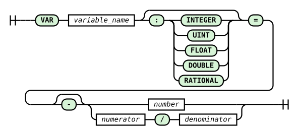

# VAR Command and DO SET Action

`VAR` declares a numeric variable shared by the entire plan. A `?NAME` reference reads its current value, and a `RULE ... DO SET` action requests an update. Variables retain state between records: an alarm latch, a counter since startup, or an exponential moving average. They do not create streams, fields, or query-tree nodes.

Unlike a [LET constant](let-command.md), which the parser substitutes, a `VAR` remains part of runtime state. The same `?` marker refers to a constant or a variable according to its declaration.

## Syntax, names, and types

```text
VAR NAME = literal
VAR NAME : TYPE = literal
RULE rule_name ON stream WHEN condition DO SET ?NAME = expression
```



The diagram is generated from the `var_statement` rule in `RQL.g4`. The declaration takes one literal, with an optional minus sign. Without an [explicit type](#explicit-type), the literal's spelling determines the variable type:

| Declaration | Variable type | Notes |
|---|---|---|
| `VAR COUNT = 0` | `INTEGER` | signed 32-bit integer |
| `VAR GAIN = 0.5` | `FLOAT` | 32-bit floating point, also for `0.0` |
| `VAR RATIO = 1/3` | `RATIONAL` | fraction with a nonzero denominator |

Strings, a `NULL` initializer, expressions (`VAR X = 1 + 2`), references (`VAR X = ?Y`), a leading plus, and exponent notation are rejected. The value must fit the literal range of its type.

A name begins with a letter and continues with letters, digits, and underscores. Names are case-sensitive; `$` is forbidden. No space is allowed after `?`. A declaration must precede its first use. `LET` and `VAR` share a namespace: redeclaring a name is an error, including changing its declaration kind. This namespace is separate from field and stream names. `VAR`, `var`, `SET`, and `set` are reserved keywords, as are type names, including `RATIONAL` and `Rational`.

### Explicit type

The annotation `VAR NAME : TYPE = literal` fixes the variable type independently of the literal's spelling. `TYPE` is `INTEGER`, `UINT`, `FLOAT`, `DOUBLE`, or `RATIONAL`, also spelled `Integer`, `Uint`, `Float`, `Double`, or `Rational`. It is the only way to declare a `UINT` or `DOUBLE` variable, because those types have no literal form of their own. Otherwise the annotation records intent in the plan: `VAR TOTAL : FLOAT = 0` instead of `VAR TOTAL = 0.0`. `STRING`, `BYTE`, and other types are syntax errors. The `LET` constant takes the same annotation ([LET - Explicit type](let-command.md#explicit-type)).

The declaration literal is converted to the given type. Conversion to `INTEGER` and `UINT` must be exact. For `RATIONAL`, the value is computed exactly from the literal text and reduced, so `0.25` gives `1/4`. For `FLOAT` and `DOUBLE`, the value is rounded as a decimal literal in an expression is. A literal with no value in the type ends compilation with a refusal naming the variable, type, and position, for example `line 1:4: value -1 of variable ?N is out of range for UINT`.

| Literal \ type | `INTEGER` | `UINT` | `FLOAT` | `DOUBLE` | `RATIONAL` |
|---|---|---|---|---|---|
| `10` | 10 | 10 | 10.0 | 10.0 | 10/1 |
| `-1` | -1 | refused | -1.0 | -1.0 | -1/1 |
| `2.5` | refused | refused | 2.5 | 2.5 | 5/2 |
| `2.0`, `4/2` | 2 | 2 | 2.0 | 2.0 | 2/1 |
| `1/3` | refused | refused | rounded | rounded | 1/3 |
| `3000000000` | refused | 3000000000 | 3000000000.0 | 3000000000.0 | refused |
| `0.123456789012` | refused | refused | rounded | rounded | refused |

`RATIONAL` stores its numerator and denominator as signed 32-bit integers. Therefore `3000000000`, and `0.123456789012`, whose reduced denominator exceeds that range, have no value in this type. `UINT` accepts literals from 0 to 4294967295.

The following plan reads `signal.txt`, where each line holds a `DOUBLE` sample and an integer marker:

```rql
VAR COUNT : UINT = 0
VAR TOTAL : DOUBLE = 0
VAR LIMIT : RATIONAL = 0.25

DECLARE x DOUBLE, k INTEGER STREAM src, 1 TEXTFILE 'signal.txt'
SELECT src[0], src[1], ?COUNT, ?TOTAL, ?LIMIT STREAM totals FROM src
RULE count ON totals WHEN totals[0] > ?LIMIT DO SET ?COUNT = ?COUNT + 1
RULE acc ON totals WHEN 1 = 1 DO SET ?TOTAL = ?TOTAL + totals[0]
RULE raise ON totals WHEN totals[1] > 0 DO SET ?LIMIT = ?LIMIT * 2
RULE clear ON totals WHEN totals[1] < 0 DO SET ?COUNT = 0
RULE restore ON totals WHEN totals[1] < 0 DO SET ?LIMIT = 0.1
```

`TOTAL` sums a `DOUBLE` field without narrowing to `FLOAT`. Without the annotation, the accumulator would need `to_float(...)` in every `SET` and would lose precision. `COUNT` is reset with the literal `0`, and `LIMIT` returns to exactly `1/10`. Both writes rely on [literal conversion in `SET`](#typing-and-null). A plan without annotations computes the same results as before annotations were introduced.

An unused variable produces a `declared but never used` warning, including with `--quiet`; using it solely as a `SET` target counts as use.

## Allowed contexts

| Context | VAR reference |
|---|---|
| scalar expression in the `SELECT` list | accepted, e.g. `src[0] * ?GAIN` |
| `RULE ... WHEN` condition | accepted, e.g. `?ALARM = 0` |
| right-hand side of `DO SET` | accepted, e.g. `?COUNT + 1` |
| field and generator indices, field and stream-family sizes | refused |
| `@` parameters, `>` shift, intervals, stream operators `&`, `%`, and `-` | refused |
| record-window width, `to_string` width, `TIMEOUT`, `RETENTION`, `DUMP` bounds | refused |
| record-window aggregate argument, e.g. `AVG(src[0] * ?GAIN : 4)` | refused |

Structural values determine the plan shape and timing; use literals or `LET` there. A VAR reference in a record-window argument is refused because a historical record does not carry the variable's historical value. To retain scaled values first, create a separate `SELECT` stream and apply the window to its fields.

The condition and the `SET` right-hand side use the current record of the `ON` stream, `LET` constants, and plan variables. A field from another stream, a stream reducer, or a record window in `SET` is refused; compute the required data in `SELECT` first. The `ON` target must be a stream created by `SELECT`. A `SET` rule on an entire generator family is refused: its copies would write one variable with the same priority. VAR state belongs to the whole plan; separate channel state requires separate declarations and rules.

## Updates become visible in the next slot

A slot is one instant on the time grid when the engine computes all due streams. All `SELECT` expressions, conditions, and `SET` right-hand sides in that slot read **the variable values from before the slot**. Updates enter a buffer and are committed only at the end of a successful slot, after source advancement. Readers see them from the next slot, regardless of their position in the plan.

A stream with another interval sees the change in its next due record. A slot is not a fixed delay in seconds. With one stream sampled every second, it is a one-sample delay. A failed slot commits no variable updates; this does not roll back records already written or effects of `DUMP` or `SYSTEM`.

### Hysteresis

This complete plan reads `signal.txt` (one integer per line):

```rql
LET ALARM_ON = 250
LET ALARM_OFF = 200
VAR ALARM = 0

DECLARE x INTEGER STREAM src, 1 TEXTFILE 'signal.txt'
SELECT src[0], ?ALARM STREAM status FROM src
RULE alarm_on ON status WHEN status[0] >= ?ALARM_ON DO SET ?ALARM = 1
RULE alarm_off ON status WHEN status[0] < ?ALARM_OFF DO SET ?ALARM = 0
```

| Slot | Input | `status[1]`: state stored in the record | ALARM after the slot |
|---|---|---|---|
| 0 | 220 | 0 | 0 |
| 1 | 260 | 0 | 1 |
| 2 | 220 | 1 | 1 |
| 3 | 190 | 1 | 0 |
| 4 | 220 | 0 | 0 |

Crossing 250 in slot 1 updates the variable after the record has been computed. The alarm field therefore becomes 1 in slot 2. Between the thresholds, the state is retained. A rule checking the sample directly can execute `DUMP` in the crossing slot; a rule checking only the variable sees the change in the next slot.

### Counter and exponential moving average

```rql
VAR COUNT = 0
VAR E = 0.0

DECLARE x INTEGER STREAM src, 1 TEXTFILE 'signal.txt'
SELECT src[0], ?COUNT, ?E STREAM history FROM src
RULE count ON history WHEN history[0] > 100 DO SET ?COUNT = ?COUNT + 1
RULE ema ON history WHEN 1 = 1 DO SET ?E = ?E * 0.5 + history[0] * 0.5
```

For the first three samples, each equal to 200:

| Slot | COUNT in the record | E in the record | COUNT after the slot | E after the slot |
|---|---|---|---|---|
| 0 | 0 | 0.0 | 1 | 100.0 |
| 1 | 1 | 100.0 | 2 | 150.0 |
| 2 | 2 | 150.0 | 3 | 175.0 |

The record shows the counter and EMA computed from earlier samples. This is a one-slot delay, like a `z^-1` register. The initial `E = 0.0` and 32-bit `FLOAT` arithmetic are part of this example.

## Conflicting updates

When several rules write the same variable in one slot, **the last firing rule in plan text order wins**, including rules on different streams. Node execution order, stream intervals, and the position of `SELECT` statements do not decide the winner. A rule with a false condition does not participate.

All right-hand sides read the same old value: two firing rules with `SET ?COUNT = ?COUNT + 1` increase the counter by 1 in total, not 2. Each rule has one action (`SET`, `DUMP`, or `SYSTEM`); multiple actions require separate rules with the same condition.

### uc10: cold room and compressor cycle counter

This example comes from the public [uc10 sketch](https://github.com/michalwidera/retractordb/issues/531#issuecomment-6254884794). Temperatures in `temp.txt` arrive every second in tenths of a degree. `hour.txt` contains one integer for each hourly tick. The compressor switches on at 5.0 degrees and off at 2.0; more than 6 cycles trigger a history dump.

```rql
LET T_ON = 50
LET T_OFF = 20
LET MAX_CYCLES = 6
VAR COMP = 0
VAR CYCLES = 0

DECLARE t INTEGER STREAM temp, 1 TEXTFILE 'temp.txt'
DECLARE k INTEGER STREAM hour, 3600 TEXTFILE 'hour.txt'
SELECT temp[0], ?COMP, ?CYCLES STREAM status FROM temp
SELECT hour[0] STREAM hour_tick FROM hour
RULE cycle ON status WHEN status[0] >= ?T_ON AND ?COMP = 0 DO SET ?CYCLES = ?CYCLES + 1
RULE comp_on ON status WHEN status[0] >= ?T_ON DO SET ?COMP = 1
RULE comp_off ON status WHEN status[0] <= ?T_OFF DO SET ?COMP = 0
RULE hour_reset ON hour_tick WHEN 1 = 1 DO SET ?CYCLES = 0
RULE short_cycling ON status WHEN ?CYCLES > ?MAX_CYCLES DO DUMP -60 TO 0
```

The `cycle` rule detects a rising edge: `COMP` is still 0 in the switch-on slot even though `comp_on` has requested 1. When `cycle` and `hour_reset` fire together, the later `hour_reset` sets `CYCLES = 0`. A cycle starting exactly in this slot is not counted in the new hour. This also applies to the initial slot shared by both streams; the slow stream does not wait an hour for its first record.

`short_cycling` also reads pre-slot state: the seventh cycle becomes visible to its condition from the next slot. The `-60 TO 0` dump contains 60 preceding records and excludes the triggering record. The example models plan state; it sends no command to a physical compressor.

Save each complete plan in a separate file and check it with `xretractor -c plan.rql`. Compilation does not require source files to exist; execution requires the named files and output directory. These examples are synthetic and do not come from the uc01-uc08 corpus used in the DEBS paper.

## Typing and NULL

A variable's type is fixed once in its declaration: by an [annotation](#explicit-type) or, without one, by the literal. An expression on the `SET` right-hand side must have exactly that type; there is no implicit conversion. With `VAR X = 0`, `SET ?X = ?X + 0.5` is a compilation refusal, as is writing `DOUBLE` to a `FLOAT` variable. Use an explicit conversion such as `to_integer(...)`, `to_float(...)`, or `to_double(...)`, or declare the variable with the expression's type. When the expression is `INTEGER`, `UINT`, `FLOAT`, `DOUBLE`, or `RATIONAL`, the refusal message suggests such a declaration: `... use an explicit conversion function or declare VAR X : FLOAT = ...`.

The exception is a `SET` right-hand side consisting of one literal, possibly negative, or one `LET` constant. The parser converts it to the variable type exactly as it converts an annotated declaration literal, computing from the literal text. `SET ?COUNT = 0` resets a `UINT` variable, `SET ?E = 0` a `FLOAT` variable, and `SET ?LIMIT = 0.1` stores exactly `1/10` in a `RATIONAL` variable. A literal with no value in the variable type is refused with the target, type, and position, for example `value -1 in DO SET ?COUNT is out of range for UINT`; the same applies to `SET ?X = 0.5` with `VAR X = 0`. Parentheses and fractions already form an expression. `(0)` is `INTEGER`, and `1/4` is integer division of type `INTEGER`, so both are refused for a `UINT` or `RATIONAL` variable, while `1/4` stored in an `INTEGER` variable gives 0. Write a fraction to a `RATIONAL` variable as the decimal literal `0.25` or through a constant: `LET Q = 1/4` and `SET ?LIMIT = ?Q`. A fractional `LET` constant is refused inside an expression but accepted as an entire `SET` right-hand side.

A NULL result, including division by zero, overflow, or a missing input field, **replaces the previous value**. The declared type stays unchanged. NULL propagates through later expressions; `?X * 0` remains NULL when X is NULL. Use `isnull(?X)` to detect it and a rule to write a valid value. `?X = 0` does not detect NULL; a condition that evaluates to NULL does not fire its action.

## Lifecycle and restart

Values start from their declaration literals on initial plan loading, reloading, an accepted `xqry --reset`, and service restart. Reloading identical text also returns state to the declaration values. VAR state is neither stored in nor recovered from artifacts. A refused ad hoc command or reset preserves the running plan's values and rules; accepted ad hoc additions retain existing variable values.

**Contract change: loss of recovery from bounded history after restart.** A plan without VAR that depends on finite input history can recover its result after rebuilding its required windows and startup tail. VAR state may depend on an arbitrarily old event, so merely waiting for `startupLatency` does not restore it. In the hysteresis example, an alarm previously set to 1 returns to 0 after restart. If later samples stay in the 200-249 band, the pre-restart state never returns; another upper-threshold crossing or replay of the relevant history from the beginning is required.

Returning to declared state is the intended behavior after interrupted monitoring: the engine makes no assumption about events during signal loss. There is currently no VAR persistence option in `config.toml`; a possible opt-in mode is a separate topic in [#543](https://github.com/michalwidera/retractordb/issues/543).

## Ad hoc and monitoring

The [ad hoc channel](../query-execution/ad-hoc-queries.md) can read the active plan's VAR values in `SELECT` and `WHEN` and attach `DO SET` rules. It cannot declare `VAR` or `LET` and does not see the plan file's `LET` constants. An attached rule starts evaluating from the next new target record; its write takes effect from the slot after it fires. It wins conflicts against plan rules and previously attached ad hoc rules. Replacing the plan removes ad hoc rules with the old epoch.

[`xqry --vars` (`-v`)](../appendices/command-line-options/xqry.md#plan-variables---vars) returns a consistent snapshot of committed values between slots, in declaration order. With `--yaml` it returns a `variables` list; `--jsonl` is refused. This is a read operation: `xqry` has no direct variable assignment command. A `DO SET` rule, including one attached ad hoc, can request updates. A snapshot between slots may already contain an update that is not yet present in the variable field of the latest `SELECT` record.

## Test coverage

The contract is guarded by `ut_compiler`, `ut_expeval`, `ut_expressionShape`, `ut_exprSimplify`, and `ut_dataModel`, plus `it_var_read-run`, `it_var_set-value`, `it_var_reset-run`, `it_var_adhoc-run`, `it_var_xqry-run`, and `it_var_typed-value`. `var_typed` checks variables annotated `UINT`, `DOUBLE`, and `RATIONAL` against a Python oracle, together with their types in `xqry --vars`. `var_set` compares hysteresis, counter, EMA, and rescaled uc10/uc11/uc12/uc14 cases against an independent Python oracle computed from the start of the run. `var_reset` demonstrates latch loss after reload. This is the scope described in the [test catalogue](../appendices/integration-tests.md), not a guarantee of persistence or device control.
